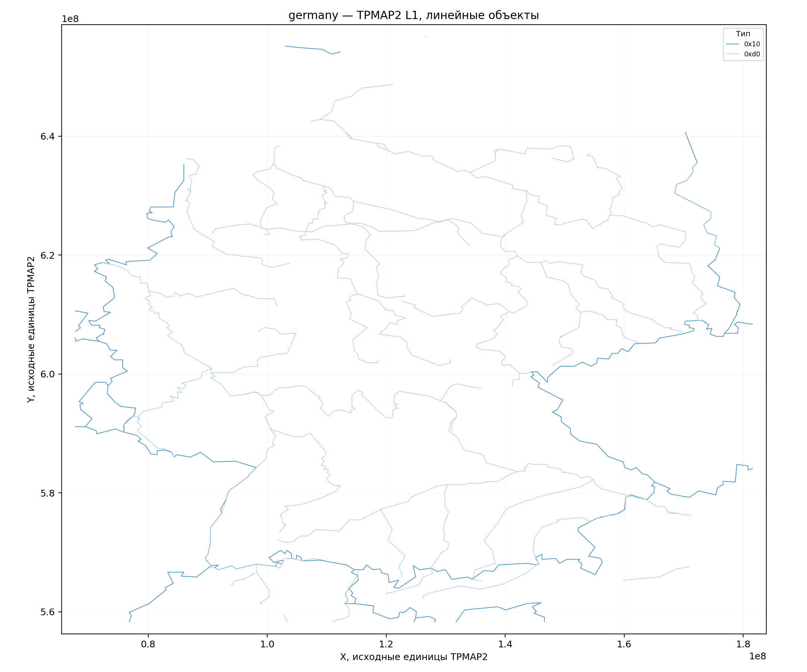
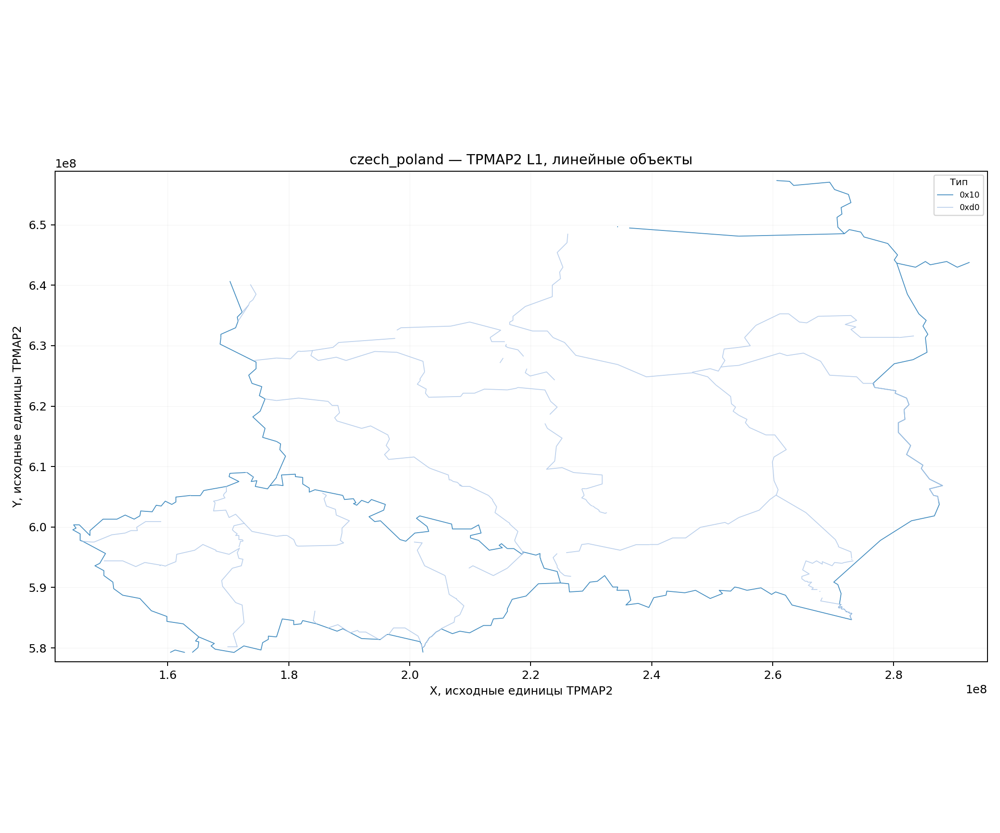
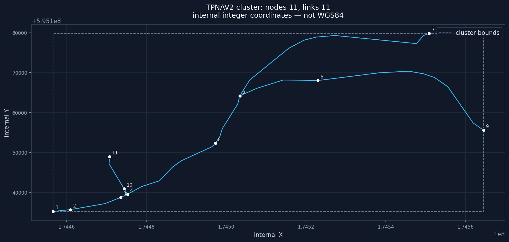
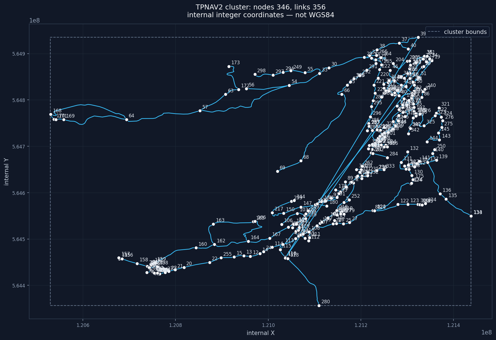
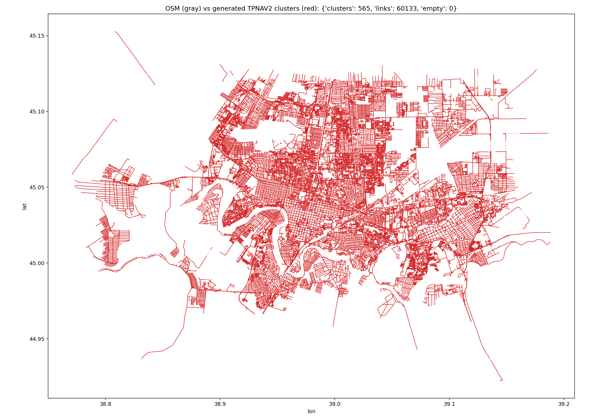

# TravelPilot DX map research

Open, read-only research tools for TeleAtlas / Blaupunkt TravelPilot DX navigation CDs, including COMAND 2.0/2.5-compatible media.

The repository contains Python decoders, validation tools, a one-command Windows 10 visualization script, compact research results, and rendered examples. **No disc images, ISO files, extracted navigation databases, firmware images, or other large source data are included.**

> Research preview: TPMAP2 geometry and selected local TPNAV2 graphs can be decoded and rendered. A stitched grid of TPNAV2 clusters can be generated from OpenStreetMap data, and a NAV container can be assembled from scratch. Iteration 8 (2026-11) established that QUADIDX/RF are name-search indexes rather than the routing address map, and narrowed the disc-level addressing question to NAV00001.DAT — but no disc with generated data has been validated on a head unit.

## Reported compatible head units

The following combined list is reported by the original 2013–2014 disc description and by external map retailers and automotive publications. It is **not an independently performed hardware matrix**: unit revisions and regional firmware may differ, and the external sources do not always publish identical model-year ranges.

- **Blaupunkt:** TravelPilot DX-V, DX-V Multimedia, and DX-V TV; TravelPilot DX-N, DX-N Online, DX-N Multimedia, and DX-N TV; TravelPilot DX-R 5, DX-R 52, DX-R 70, and DX-R 4; and Radio Navigation System RNS4.
- **Alfa Romeo:** DX / RNS4.
- **Audi:** Navigation Plus RNS4.X (from 12/1999) and Navigation BNS4.X. Detailed listings associate BNS4.X with A2, A3, and TT from 07/2001; A4 from 11/2000; A6 from 05/2001; and A8 from 01/2001.
- **Fiat:** DX.
- **Ford:** TravelPilot from 03/2001; MFD from 01/2001; and Galaxy 2-DIN Radio Navigation System (01/2001–09/2005).
- **Honda:** TravelPilot DX-N.
- **Lancia:** DX.
- **Maserati:** Quattroporte (M139).
- **Mercedes-Benz:** CD-based COMAND DX / COMAND APS 2.0 / COMAND APS 2.5. Detailed listings name C-Class, CL-Class, CLK-Class, E-Class, G-Class, M-Class, S-Class, and SL applications. These discs **do not fit** the Auto Pilot System or Audio 30/50 APS.
- **Peugeot:** TravelPilot DX RNS4.
- **Seat:** DX / DNS; detailed listings name Alhambra, Leon, Ibiza, and Toledo from 05/2001.
- **Skoda:** DX; detailed listings name Octavia, Fabia, and Superb, while automotive reporting also mentions NEXUS DX in Octavia and Superb.
- **Volkswagen:** MCD from 11/2000; MFD from 01/2000; MFD Touareg; and T5 Multivan. Automotive reporting also mentions CD-based MFD2 applications in Sharan and Passat. CD/DVD unit variants must not be assumed interchangeable.

Vehicle examples mentioned by an automotive report include Audi A4/A6, Ford Galaxy, Mercedes-Benz E-Class and M-Class, Seat Alhambra, Skoda Octavia and Superb, and Volkswagen Passat and Sharan. These examples describe applications reported for DX-era systems, not a guarantee that every trim or region used the same unit.

External compatibility references used for this expanded list: [Comand Online](https://www.commandonline.co.uk/teleatlas-italy-dx.html?printable=Y), [Audiocom](https://www.audiocom.cz/navigacni-software/blaupunkt/navigacni-cd-rom-dx-mapa-nemecko-2013-2014-hlavni-trasy-evropy-mre-2013-2014--3366cz), and [Auto Świat](https://www.auto-swiat.pl/porady/fabryczna-nawigacja-prowadzi-w-strone-klopotow/875cpre). This research project did not test physical units or modified discs.

## Quick start on a fresh 64-bit Windows 10 installation

Requirements:

- an original, unfragmented CloneCD Mode 1/2352 `.img` file;
- an internet connection for the first run;
- approximately 2 GB of free disk space (more for unusually large discs);
- no preinstalled Python, Git, ISO mounting tool, or administrator rights.

Open PowerShell in the repository directory and run:

```powershell
powershell -NoProfile -ExecutionPolicy Bypass -File .\visualize.ps1 -DiskImage "D:\discs\germany.img"
```

Alternatively, use the batch wrapper:

```bat
visualize.bat "D:\discs\germany.img"
```

The script:

1. finds a suitable Python 3.10+ interpreter;
2. if none exists, downloads the signed official Python 3.12 installer and installs a private copy under `.runtime\` without changing the system PATH;
3. creates `.venv` and installs `pycdlib` and `matplotlib`;
4. converts the source `.img` to ISO in the output directory without modifying the source;
5. extracts only `MAP00001.MAP` and its SHA-256 manifest;
6. renders the level-1 map to `output\map-L1.png` and opens the image.

An ISO can be supplied instead of a CloneCD image:

```powershell
powershell -NoProfile -ExecutionPolicy Bypass -File .\visualize.ps1 -DiskImage "D:\discs\germany.iso"
```

### Visualization options

Render selected level-3 tiles, including table-A polygons:

```powershell
powershell -NoProfile -ExecutionPolicy Bypass -File .\visualize.ps1 `
  -DiskImage "D:\discs\germany.img" `
  -Level 3 `
  -Indices "43661" `
  -IncludeAreas
```

Use a different output directory and do not open the result automatically:

```powershell
powershell -NoProfile -ExecutionPolicy Bypass -File .\visualize.ps1 `
  -DiskImage "D:\discs\germany.img" `
  -OutputDirectory "D:\dx-output" `
  -NoOpen
```

`-Indices` accepts comma-separated zero-based indices and inclusive ranges, for example `"43661,44814-44816"`. Level 2 may contain tens of thousands of blocks and can take considerable time. Do not render all level-3 blocks unless you understand the resource cost.

See [the detailed Windows guide](docs/WINDOWS.md).

## What has been established

- Eleven TeleAtlas DX discs from 2010–2011 and 2013–2014 were converted and inventoried. Five sets were fully extracted with SHA-256 manifests.
- `MAP00001.MAP` is a Bosch **TPMAP2** container produced from GDF 3.0 input. It is not itself an ASCII Sequential GDF file.
- Four hierarchical TPMAP2 directories, block headers, polygon/line/point tables, tile coordinates, and hierarchical tile addressing were recovered from NEC V810 machine code.
- Tile addressing passed **62,135 round-trip checks** across five MAP files.
- The TPNAV2 container and LZ decompressor were validated on **3,815 entries in nine NAV files**, totaling **60,404,019 decoded bytes**, with no decode, declared-size, or stream-boundary errors.
- **37 of 128** examined graph candidates yielded fully locally consistent node/link topology. The remaining candidates contain unresolved nonlocal endpoints or unclassified sections; this does not imply that they contain no navigation data.
- Selected line styles and hydrographic labels were established. The semantics of types `0x10` and `0xf0` remain unresolved.
- Same-length replacement of an ISO file inside a CloneCD copy was tested at sector level. This is not a map-editing test or a head-unit compatibility test.
- A fitted plate-carree-like datum converts internal units to WGS84 (1 unit ≈ 9.3 mm; 249 city-label anchors; residual median ~0.6 km — sufficient for generating self-consistent regions, not for stitching to untouched TeleAtlas clusters).
- **OSM → TPNAV2 cluster grid proven**: Olomouc 4,850/4,850 boundary ends stitched, Krasnodar 11,344/11,344, zero endpoint conflicts, automatic grid refinement up to 32×32 (`tools/tpdx_osm_grid.py`, `tools/fetch_osm.py`).
- **NAV container assembly from scratch proven**: 565 generated clusters round-trip byte-identically (`tools/tpnav2_nav_build.py`); cluster synthesis without a donor image (`tools/tpnav2_cluster_gen.py`), graph mutation with full re-layout (`tools/tpnav2_graph_mutate.py`), and sector-safe same-length patching of a NAV inside a CloneCD image (`tools/tpnav2_nav_patch.py`).
- Boundary-transition stitching statistics for Germany (897 NAV files, 20,254 matched ends, 73 unique transition bodies) are published in `results/boundary-body-matches.json` and `results/boundary-word-matches.json`.
- **QUADIDX.DAT / RF_1_1_*.DAT are name-search indexes** (destination and travel-guide search), not the routing address map: each disc's `INFO.TXT` lists them as `Quad-Idx …_GIS` and `…rf …travel_guide`, the decoded header carries destination-search UI strings ("Ort A-Z", "Name eingeben", "Zielführung"), and the firmware holds no direct references (names are assembled in RAM). Details: `docs/TECHNICAL_REPORT.md` §4.1.
- **MAP↔NAV linkage candidates rejected** (2026-11): MAP00001.MAP does not store NAV file numbers (chance-level intersections), and TPMAP2 catalog blocks do not correspond 1:1 to NAV files. NAV containers are read by handle through a block cache. The current addressing candidate is `NAV00001.DAT`, a paged sorted index whose block-leading keys increase monotonically on two discs — under active decoding.
- Firmware reverse-engineering is reproducible with the bundled Ghidra scripts; see `docs/GHIDRA.md` for the headless recipe (including the `-process` naming pitfall).

Coordinates produced by the renderers are **signed internal TPMAP2/TPNAV2 integer units, not WGS84**; the fitted datum in `results/tpdx-datum.json` converts them (`tools/tpdx_coords.py`).

## Rendered examples

| Germany TPMAP2 L1 | Czech/Poland TPMAP2 L1 |
|---|---|
|  |  |

| Small TPNAV2 local graph | Larger TPNAV2 local graph |
|---|---|
|  |  |

| OSM (gray) vs generated TPNAV2 grid, Krasnodar |
|---|
|  |

## Manual Python usage

The Windows script is the recommended path for a new installation. On an existing Python 3.10+ setup:

```powershell
python -m venv .venv
.\.venv\Scripts\python.exe -m pip install -r requirements.txt
.\.venv\Scripts\python.exe tools\clonecd_to_iso.py "D:\discs\germany.img" "output\disc.iso"
.\.venv\Scripts\python.exe tools\extract_map.py "output\disc.iso" "output\MAP00001.MAP"
.\.venv\Scripts\python.exe tools\tpmap_geometry.py render "output\MAP00001.MAP" --level 1 --output "output\map-L1.png"
```

Run the self-contained tests:

```powershell
.\.venv\Scripts\python.exe -m unittest discover -s tests -v
```

Integration tests that require private source discs are skipped when those data are absent. They can be enabled by recreating the paths documented in the test modules; source data are not downloaded by the tests.

## Repository layout

```text
visualize.ps1 / visualize.bat  Windows 10 bootstrap and end-to-end rendering
requirements.txt              Python dependencies
tools/                        CloneCD, ISO, TPMAP2 and TPNAV2 research tools
tools/ghidra_scripts/         Ghidra headless scripts (see docs/GHIDRA.md)
tests/                        Self-contained regression tests
examples/                     Small rendered PNG examples
results/                      Compact validation reports and surveys
docs/                         Windows instructions, format notes, sources,
                              and the Ghidra firmware-analysis recipe
```

Generation pipeline (tools): `tpdx_osm_grid.py` (OSM→cluster grid), `tpnav2_cluster_gen.py` (cluster synthesis), `tpnav2_nav_build.py` (NAV container assembly), `tpnav2_graph_mutate.py` / `tpnav2_graph_write.py` (model mutation + serialization), `tpnav2_nav_patch.py` (CloneCD image patching), `tpdx_coords.py` + `tpdx_datum_fit.py` (WGS84 datum). Survey/analysis tools: `tpnav2_endpoint_survey.py`, `tpnav2_cross_probe.py`, `tpnav2_shared_coords.py`, `tpnav2_firmware_pass.py`, `tpnav2_germany_stitch.py`, `tpdx_label_survey.py`, `tpmap_directory.py`. Several research tools default to an `extracted/` + `analysis/` workspace layout and expect disc-derived data that is not distributed here.

## Scope and limitations

Not yet implemented:

- complete road attributes, turn restrictions, address and search indexes;
- the disc-level coordinate→NAV addressing path: QUADIDX is proven to be a name-search index, MAP↔NAV number links are rejected; `NAV00001.DAT` (paged sorted index) is the active candidate and is not yet decoded;
- TPMAP2 serialization (TPNAV2 graph serialization is proven);
- firmware acceptance tests of generated clusters and of >256 entries per NAV file (verifiable only on a head unit);
- emulation of a complete head unit;
- validation of a modified CD-R on physical hardware.

The included same-length CloneCD patcher is experimental. Work only with copies, preserve the original `.ccd`, `.img`, and `.sub`, and do not assume that a byte-correct image will be accepted by a head unit.

## Research documentation

- [Windows 10 visualization guide](docs/WINDOWS.md)
- [Technical report](docs/TECHNICAL_REPORT.md)
- [Ghidra firmware-analysis recipe](docs/GHIDRA.md)
- [References and provenance](docs/SOURCES.md)

## Legal and project status

This is an independent interoperability research project. Blaupunkt, TeleAtlas, Bosch, COMAND, and other names belong to their respective owners. Use only media and data you are legally entitled to possess and analyze. No proprietary disc contents are distributed here.

The original research code and documentation in this repository are provided under the MIT License. See [LICENSE](LICENSE).
