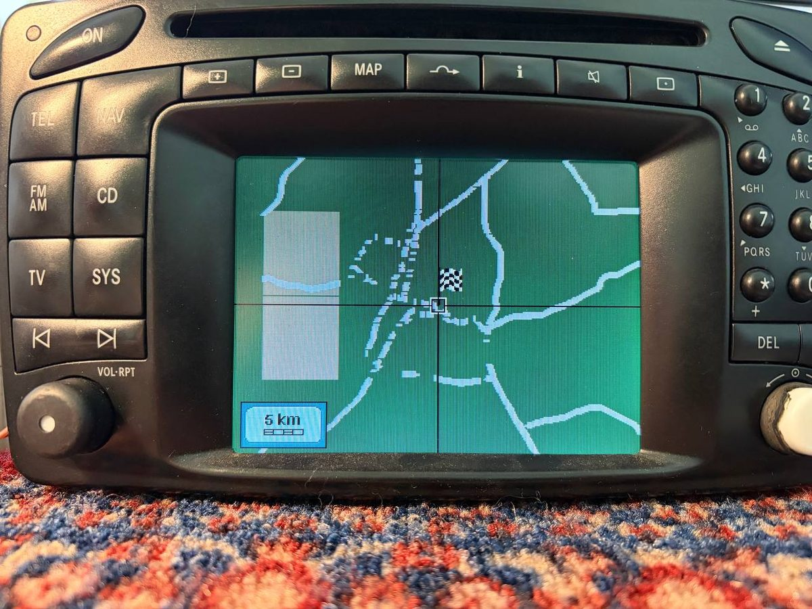
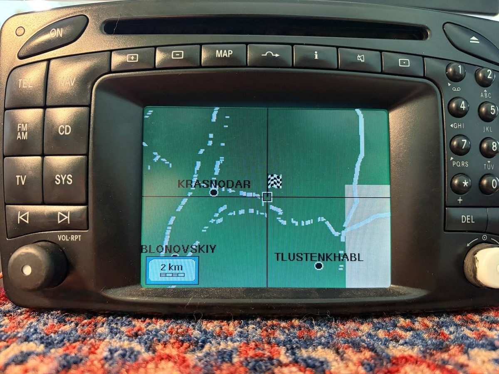
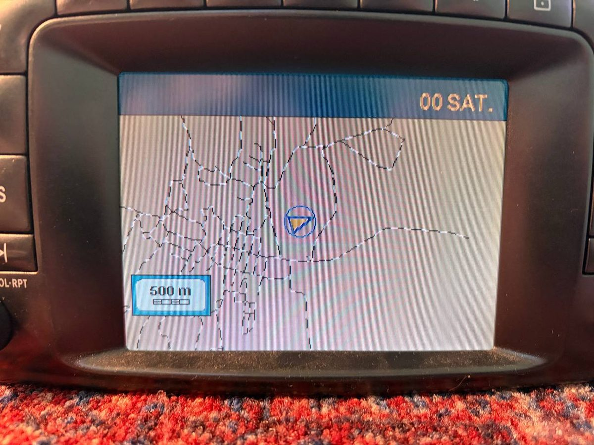

# Head-unit field-test screenshots

Field tests on a Mercedes-Benz COMAND 2.0 head unit (firmware updated from the
MY01 service disc, 2026-11-16). Disc **v8** = donor CloneCD image with a fully
generated map region: TPMAP2 map of Krasnodar Krai built from OpenStreetMap
(`tools/tpmap_build.py`) + regenerated NAV2 container with the full catalog stack
(`tools/tpnav7_nav_assemble.py`). The unit had no GPS antenna attached; the map was
centred by the coordinate-entry feature (45°01'14"N 39°01'52"E, central Krasnodar).

At 5 km the generated road network renders correctly.

At 2 km the generated NAV name layer renders real place labels with correct
positions: KRASNODAR, BLONOVSKIY and TLUSTENKHABL (Tlustenhabl, a village SW of
Krasnodar). The pseudo-Cyrillic glyphs are the unit's built-in lookalike-font
transliteration; the stored names are plain Latin.

At 500 m the generated street geometry is drawn with full detail.

## Known issues observed on the unit

- Zooms 50/20 km (position-dependent: some spots only 50 km) freeze the unit
  into a reboot on discs with generated regions. Zoom 10 km was cured by capping
  level-2 records to the donor envelope; the remaining crash at 50/20 km is the
  main open defect (suspect: overview-level labels / town-point captions).
- The destination city list is still the donor's (Polish/Czech cities); adding
  renamed records to QUADIDX.DAT (disc v10) did not change the list — the exact
  source structure of "Ortsliste" is unresolved (see docs/QUADIDX_FORMAT.md).
